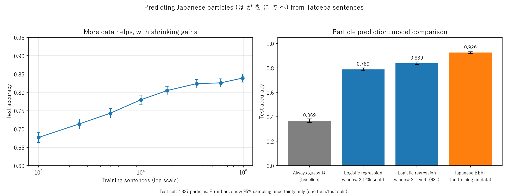

# aiml-learning

Learning AI/ML from scratch with Python: NumPy, pandas, scikit-learn and PyTorch practice scripts,
plus one small research project.

## Project: predicting Japanese particles

**Question:** given a Japanese sentence with one particle hidden, how well can a model guess which
of the six common particles (は が を に で へ) goes in the gap? How far do simple context features
and more data take a logistic regression model, and how does it compare with a pretrained Japanese
BERT that was never trained on this data?

- Data: Japanese sentences from [Tatoeba](https://tatoeba.org), tokenized with Janome.
- Split: a sentence goes to the test set if `sid % 10 == 0` (sentence index in file order),
  otherwise to train. The test set is every 10th of the first 20,000 sentences: **4,327 particles**.
  All models, BERT included, are scored on these same 4,327 examples.
- Models: majority-class baseline, logistic regression on one-hot context words/POS (± the next
  verb's base form), and zero-shot masked-LM prediction with
  [`tohoku-nlp/bert-base-japanese-char-v3`](https://huggingface.co/tohoku-nlp/bert-base-japanese-char-v3),
  restricted to the six candidate particles.

## Reproduce

Tested on Linux, Python 3.10, CPU only.

```bash
python -m venv .venv && source .venv/bin/activate
pip install --index-url https://download.pytorch.org/whl/cpu torch==2.14.1   # CPU build of torch
pip install -r requirements.txt

mkdir -p data
curl -L -o data/jpn_sentences.tsv.bz2 \
  https://downloads.tatoeba.org/exports/per_language/jpn/jpn_sentences.tsv.bz2
```

Then run, in this order (each script reads files under `data/` written by the earlier ones):

| # | Command | Produces / reports | Time (2 CPU cores) |
|---|---------|--------------------|--------------------|
| 1 | `python build_dataset.py` | `data/particle_examples.csv`, baseline | < 1 min |
| 2 | `python train_particles.py` | LR on prev2/prev1/next1/next2 (+POS) | < 1 min |
| 3 | `python context_experiment.py` | `data/tokens.pkl`, window-size table | ~4 min |
| 4 | `python verb_experiment.py` | `data/tokens_base.pkl`, window 2 / +verb table | ~3 min |
| 5 | `python learning_curve.py` | learning curve, 1k–18k sentences (needs step 4) | ~2 min |
| 6 | `python scale_up.py` | `data/tokens_100k.pkl`, learning curve, 18k–98k sentences | ~8 min |
| 7 | `python bert_eval.py` | `data/bert_predictions.csv`, BERT zero-shot (needs step 6) | ~8 min |
| 8 | `python make_figures.py` | `figures/particle_results.png` | seconds |

Optional analysis: `error_analysis.py` (needs step 1), `bert_errors.py` (needs step 7),
`mask_test.py` (BERT sanity check).

Notes:
- The BERT tokenizer uses MeCab word segmentation, so `fugashi` and `unidic-lite` are required
  even though no script imports them directly.
- `make_figures.py` tries Windows (Yu Gothic, Meiryo, MS Gothic), macOS (Hiragino Sans) and Linux
  (Noto Sans CJK JP, IPAexGothic) Japanese fonts. On Linux, install one first (e.g.
  `sudo apt install fonts-noto-cjk`), or the kana in the figure come out as empty boxes.
- The numbers in `make_figures.py` are hardcoded from the runs below. If you change an
  experiment, update them by hand.

## Results

Test accuracy on the 4,327 test particles. The 95% interval from test-set sampling alone is about
±0.012–0.014 (`1.96*sqrt(p(1-p)/4327)`), and every reproduced number falls inside it.

| Model | Script | Accuracy (published) | Accuracy (reproduced) |
|-------|--------|---------------------:|----------------------:|
| Always guess は (baseline) | `build_dataset.py` | 0.369 | 0.369 |
| Logistic regression, window 2 (20k sentences) | `verb_experiment.py` / `context_experiment.py` | 0.789 | 0.789 |
| Logistic regression, window 3 + next verb (98k sentences) | `scale_up.py` | 0.839 | 0.839 |
| Japanese BERT, zero-shot | `bert_eval.py` | 0.926 | 0.926 |

Learning curve (logistic regression, window 3 + next verb):

| Training sentences | 1,000 | 2,500 | 5,000 | 10,000 | 18,000 | 35,000 | 60,000 | 98,000 |
|---|---|---|---|---|---|---|---|---|
| Published | 0.677 | 0.714 | 0.743 | 0.780 | 0.805 | 0.824 | 0.826 | 0.839 |
| Reproduced | 0.677 | 0.714 | 0.743 | 0.780 | 0.806 | 0.821 | 0.828 | 0.839 |

`train_particles.py` (a simpler feature set: prev2/prev1/next1/next2 plus POS) gives 0.787; that number is not in the figure.

(1k–18k come from `learning_curve.py`; 18k–98k come from `scale_up.py`. `scale_up.py` gives 0.806 at
18k, and so does `learning_curve.py`.)


